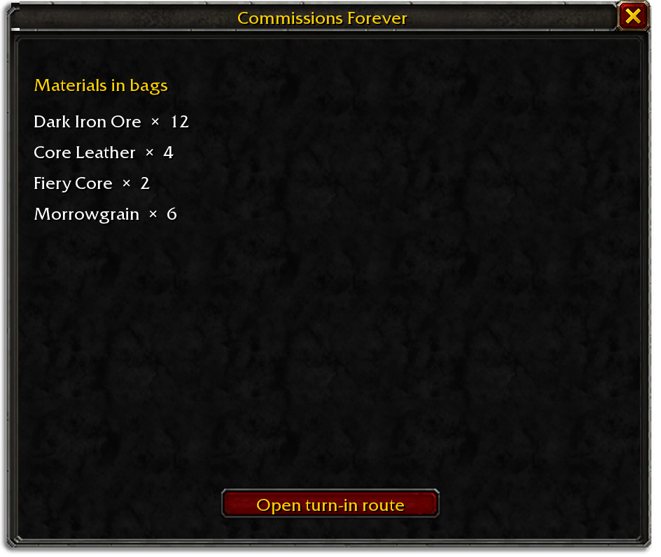

<h1 align="center">Commissions Forever</h1>

Track materials for repeatable WoW: Forever turn-ins. Open the list with `/commissions` or `/cf`.

## Features

- **Repeatable turn-ins.** One list covers Argent Dawn writs, Cenarion Circle Logistics, Thorium Brotherhood, Timbermaw Hold, and Morrowgrain research.
- **Live assignment objectives.** QuestieDB adds item objectives and finishers from active commission quests; the quest log supplies the required count.
- **Bag counts.** Item totals refresh after your bags or quest log change.
- **Travel guidance.** If Shortest Path Forever is installed, send the remaining commission finishers as one route.
- **Craft breakdowns.** If SkillUp Forever is installed, integrations can read raw recipe materials through its public API.

The list groups your held materials and offers a route to active commission turn-ins.

<!-- forever-family:start -->

## The Forever addons

Each one works on its own, and they work together when you install more than one.

| Addon | What it does |
|---|---|
| [Shortest Path Forever](https://www.curseforge.com/wow/addons/shortest-path-forever) | Plans journeys on foot, by air, by sea and through portals, with directions in the tracker. |
| [Adventure Guide Forever](https://www.curseforge.com/wow/addons/adventure-guide-forever) | Suggests quests for your level and routes you from one to the next. |
| [SkillUp Forever](https://www.curseforge.com/wow/addons/skillup-forever) | Shows skill-up chances, recipe costs and levelling routes in the Professions window. |
| [Legacy Forever](https://www.curseforge.com/wow/addons/legacy-forever) | Shows your unfinished Legacy challenges on the world map and tracks the ones you choose. |
| [Tweaks Forever](https://www.curseforge.com/wow/addons/tweaks-forever) | Adds quest automation, rare alerts and merchant options to the game's settings. |

<!-- forever-family:end -->

## Install

Install Commissions Forever from GitHub, CurseForge or Wago. QuestieDB, SkillUp Forever and Shortest Path Forever are optional.

## Usage

Use `/commissions` or `/cf` to open the window. Choose **Open turn-in route** to send the active commission stops to Shortest Path Forever.

## Data

Turn-in materials are listed by item ID. Active quest requirements and NPC locations come from the current quest log and QuestieDB at runtime. Variable logistics assignments and writs are not guessed from their names.

Other addons can call `CommissionsForever.API.RequiredMaterials(recipeID, crafts)` to ask SkillUp Forever for raw recipe inputs, or use `ActiveObjectives()` and `NavigateActiveAssignments()` for current commission objectives and route guidance.

## Works alongside

QuestieDB provides quest and NPC data. SkillUp Forever can expand recipe inputs into raw materials. Shortest Path Forever handles travel between active quest finishers. Each addon remains optional.

## Development

Run `stylua --check .`, `luacheck .`, and every `tests/*_spec.lua` with LuaJIT. Render the UI with `python3 tools/screenshots.py` and run `python3 tools/visual_audit.py` before changing a screenshot.

## Credits

Thanks to Cillian Berragan for the idea; Blizzard for the client APIs; and the QuestieDB, SkillUp Forever and Shortest Path Forever projects for optional public integrations. See [THIRD_PARTY.md](THIRD_PARTY.md) for data sources and licences.

## Licence

GPL-3.0-or-later. See [LICENSE](LICENSE).

## Development

Run `stylua --check .`, `luacheck .`, and `luajit tests/model_spec.lua`. Before release, run the complete Sift gate and visual audit, render screenshots, and check the packaged TOC.
