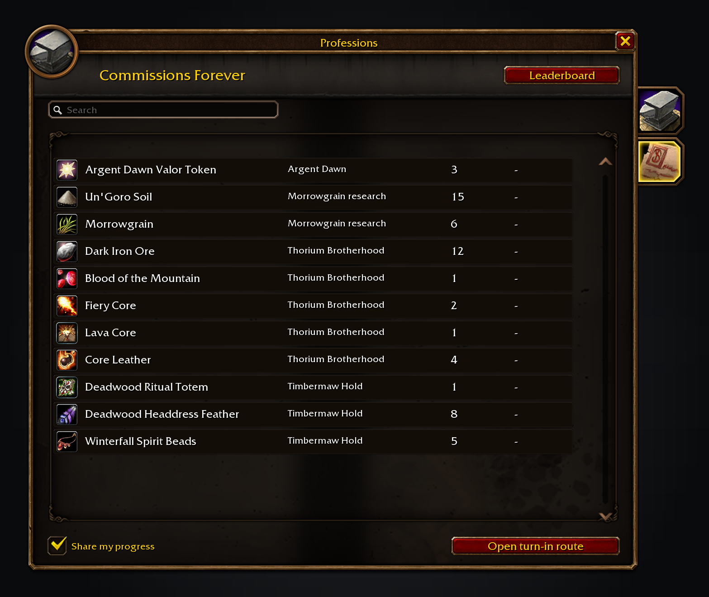

<h1 align="center">Commissions Forever</h1>

Track materials for repeatable WoW: Forever turn-ins. Open its Professions page with `/commissions`.

Free, open source, and nothing is locked behind it.

## Features

- **Repeatable turn-ins.** One list covers Argent Dawn writs, Cenarion Circle Logistics, Thorium Brotherhood, Timbermaw Hold, and Morrowgrain research.
- **Live assignment objectives.** QuestieDB adds item objectives and finishers from active commission quests; the quest log supplies the required count.
- **Bag counts.** Item totals refresh after your bags or quest log change.
- **Observed turn-in totals.** Supported hand-ins are counted from the moment you install the addon, and other addons can read the total through its public API.
- **Travel guidance.** If Shortest Path Forever is installed, send the remaining commission finishers as one route.

The list groups your held materials and offers a route to active commission turn-ins.

<!-- forever-family:start -->

## The Forever addons

Each one works on its own, and they work together when you install more than one.

| Addon | What it does | Issues |
|---|---|---|
| [Shortest Path Forever](https://www.curseforge.com/wow/addons/shortest-path-forever) | Plans journeys on foot, by air, by sea and through portals, with directions in the tracker. | [Issues](https://github.com/cjber/shortest-path-forever/issues) |
| [Adventure Guide Forever](https://www.curseforge.com/wow/addons/adventure-guide-forever) | Suggests quests for your level and routes you from one to the next. | [Issues](https://github.com/cjber/adventure-guide-forever/issues) |
| [SkillUp Forever](https://www.curseforge.com/wow/addons/skillup-forever) | Shows skill-up chances, recipe costs and levelling routes in the Professions window. | [Issues](https://github.com/cjber/skillup-forever/issues) |
| [Legacy Forever](https://www.curseforge.com/wow/addons/legacy-forever) | Shows your unfinished Legacy challenges on the world map and tracks the ones you choose. | [Issues](https://github.com/cjber/legacy-forever/issues) |
| [Tweaks Forever](https://www.curseforge.com/wow/addons/tweaks-forever) | Adds quest automation, rare alerts and merchant options to the game's settings. | [Issues](https://github.com/cjber/tweaks-forever/issues) |
| [Field Guide Forever](https://www.curseforge.com/wow/addons/field-guide-forever) | Keeps a cosmetic journal of the creatures you kill, zone by zone. | [Issues](https://github.com/cjber/field-guide-forever/issues) |
| [Commissions Forever](https://www.curseforge.com/wow/addons/commissions-forever) | Lists your commission turn-ins, the materials in your bags and the next NPC to visit. | [Issues](https://github.com/cjber/commissions-forever/issues) |
| [Macro Assist Forever](https://www.curseforge.com/wow/addons/macro-assist-forever) | Adds a macro window with every macro in one list, a mono editor with live checks, and history. | [Issues](https://github.com/cjber/macro-assist-forever/issues) |

Bug reports, feature requests and pull requests are welcome on each addon's GitHub. Everyone whose report or idea ships is thanked by name on the Thanks page in game, in the store page and in the changelog, unless they ask not to be.

For help, ideas and each day's release notes, join [cjber's Workshop on Discord](https://discord.gg/FpHugGxRJY).

<!-- forever-family:end -->

## Install

Install Commissions Forever from its GitHub release. QuestieDB, SkillUp Forever and Shortest Path Forever are optional.

## Usage

Use `/commissions` to open its page in the Professions window. Choose **Open turn-in route** to send the active commission stops to Shortest Path Forever.

## Data

Turn-in materials are listed by item ID. Active quest requirements and NPC locations come from the current quest log and QuestieDB at runtime. Variable logistics assignments and writs are not guessed from their names.

Other addons can read this addon through `CommissionsForever.API`: [docs/api.md](docs/api.md) lists its functions, the rows they return, the not-ready reasons and the minor history.

Completions are recorded from `QUEST_TURNED_IN`, beginning when this version is installed. QuestieDB must identify a repeatable commission with a finisher, matching materials or starter item, and the expected reputation reward. Bag changes, quest titles and route clicks never count. Each actual repeat hand-in counts again. One-time tasks, Forever commerce work orders without repeatable metadata, and missing classification fields are unsupported. Nothing is backfilled from earlier play. See [completion records](docs/completions.md) for scope and client checks.

## Works alongside

QuestieDB provides quest and NPC data. SkillUp Forever can expand recipe inputs into raw materials. Shortest Path Forever handles travel between active quest finishers. Each addon remains optional.

## Development

Run `stylua --check .`, `luacheck .`, and every `tests/*_spec.lua` with LuaJIT. Render the UI with `python3 tools/screenshots.py` and run `python3 tools/visual_audit.py` before changing a screenshot.

## Credits

Thanks to Blizzard for the client APIs, and to the QuestieDB, SkillUp Forever and Shortest Path Forever projects for optional public integrations. [THIRD_PARTY.md](THIRD_PARTY.md) lists every input and the full credits.

<!-- forever-credits:start -->

Thanks to everyone who reports a bug or asks for a feature.

<!-- forever-credits:end -->

## Licence

GPL-3.0-or-later. See [LICENSE](LICENSE).

The addon is free and stays GPL-3.0. If it saves you time, you can [sponsor me on GitHub](https://github.com/sponsors/cjber), which takes no fees, or [buy me a coffee on Ko-fi](https://ko-fi.com/cjber); nothing is locked behind it and there is no paid version.
