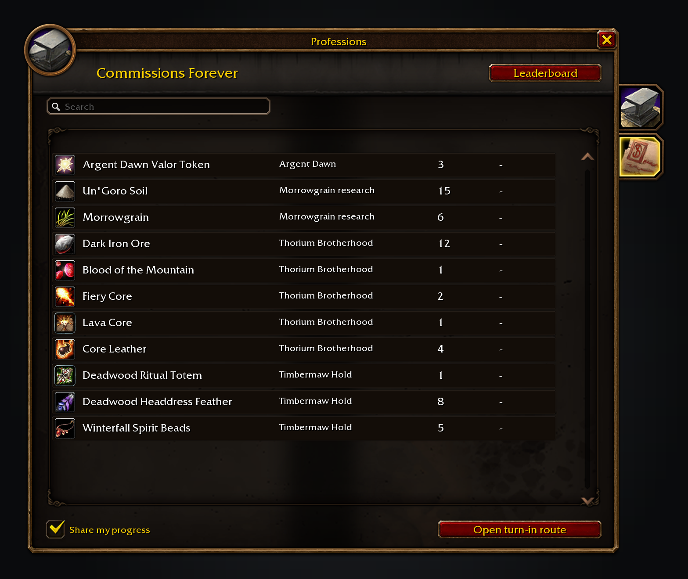
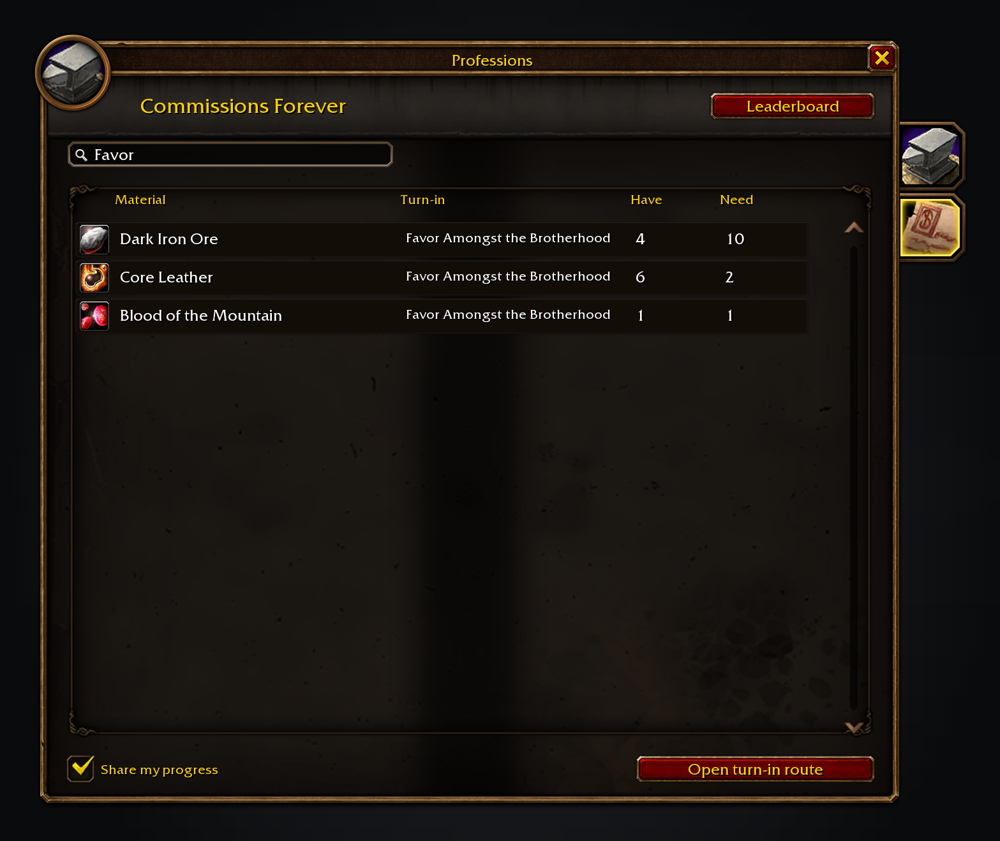
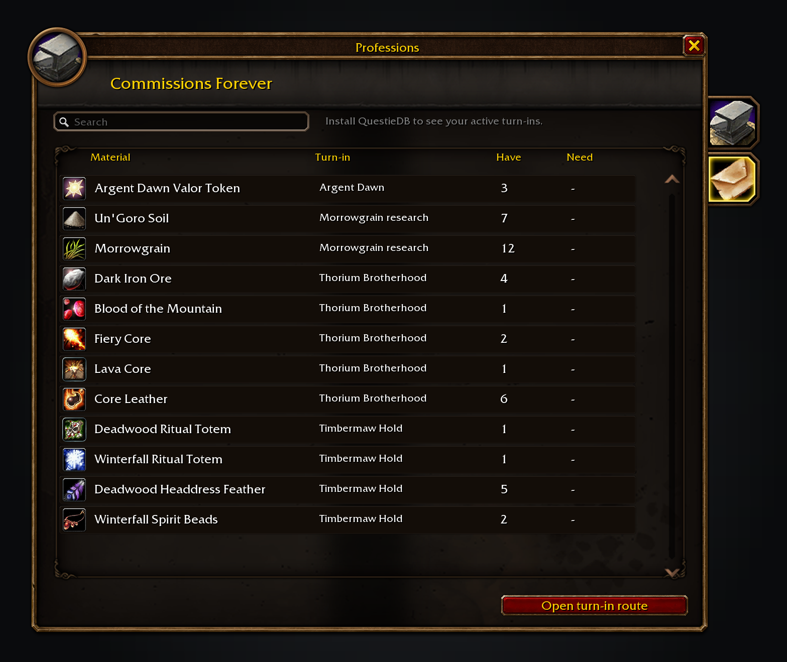

Commissions Forever keeps repeatable turn-ins in view on its own page in the Professions window. It lists the materials in your bags, shows what each active assignment still needs, and sends the remaining stops to Shortest Path Forever.

QuestieDB, SkillUp Forever and Shortest Path Forever are optional. QuestieDB supplies active quest finishers and their locations; without it the list still counts your materials.

Free, with nothing locked behind it. If it saves you time, you can [sponsor me on GitHub](https://github.com/sponsors/cjber), which takes no fees, or [buy me a coffee on Ko-fi](https://ko-fi.com/cjber). For help and each day's release notes, [join me on Discord](https://discord.gg/FpHugGxRJY).

  

Active assignments come first, with the count in your bags beside what the quest still asks for.

The search box narrows the list to one material, assignment or faction.

Without QuestieDB, the list still counts the turn-in materials in your bags.

These images are generated previews of the Commissions UI.

## Features

- **One list for turn-ins.** Argent Dawn writs, Cenarion Circle logistics, Thorium Brotherhood materials, Timbermaw Hold items and Morrowgrain research appear together.
- **Live counts.** Bag and quest-log changes refresh the list, and active quest objectives fill in the Need column.
- **Route to the next stop.** Open turn-in route sends the active commission finishers to Shortest Path Forever, which guides you between them.
- **Recipe materials.** When SkillUp Forever is installed, other addons can ask its public API for the raw reagents behind a recipe.
- **Observed totals.** Supported hand-ins are counted from the moment you install the addon, and other addons can read the total through its public API.

Completions are counted from real repeat hand-ins from the moment you install the addon. Nothing is backfilled from earlier play, and variable logistics assignments are not guessed from their names.

## Usage

Use `/commissions` to open its page in the Professions window. Choose **Open turn-in route** to send the active commission stops to Shortest Path Forever.

For a bug report, paste `/commissions report`.

<!-- forever-family:start -->

## The Forever addons

Each one works on its own, and they work together when you install more than one.

| Addon | What it does | Issues |
|---|---|---|
| [Shortest Path Forever](https://www.curseforge.com/wow/addons/shortest-path-forever) | Plans journeys on foot, by air, by sea and through portals, with directions in the tracker. | [Issues](https://github.com/cjber/shortest-path-forever/issues) |
| [Adventure Guide Forever](https://www.curseforge.com/wow/addons/adventure-guide-forever) | Suggests quests for your level and routes you from one to the next. | [Issues](https://github.com/cjber/adventure-guide-forever/issues) |
| [SkillUp Forever](https://www.curseforge.com/wow/addons/skillup-forever) | Shows skill-up chances, recipe costs and levelling routes in the Professions window. | [Issues](https://github.com/cjber/skillup-forever/issues) |
| [Legacy Forever](https://www.curseforge.com/wow/addons/legacy-forever) | Shows your unfinished Legacy challenges on the world map and tracks the ones you choose. | [Issues](https://github.com/cjber/legacy-forever/issues) |
| [Tweaks Forever](https://www.curseforge.com/wow/addons/tweaks-forever) | Adds quest automation, rare alerts and merchant options to the game's settings. | [Issues](https://github.com/cjber/tweaks-forever/issues) |
| [Field Guide Forever](https://www.curseforge.com/wow/addons/field-guide-forever) | Keeps a cosmetic journal of the creatures you kill, zone by zone. | [Issues](https://github.com/cjber/field-guide-forever/issues) |
| [Commissions Forever](https://www.curseforge.com/wow/addons/commissions-forever) | Lists your commission turn-ins, the materials in your bags and the next NPC to visit. | [Issues](https://github.com/cjber/commissions-forever/issues) |
| [Macro Assist Forever](https://www.curseforge.com/wow/addons/macro-assist-forever) | Adds a macro window with every macro in one list, a mono editor with live checks, and history. | [Issues](https://github.com/cjber/macro-assist-forever/issues) |

Bug reports, feature requests and pull requests are welcome on each addon's GitHub. Everyone whose report or idea ships is thanked by name on the Thanks page in game, in the store page and in the changelog, unless they ask not to be.

For help, ideas and each day's release notes, join [cjber's Workshop on Discord](https://discord.gg/FpHugGxRJY).

<!-- forever-family:end -->

Data comes from the WoW client and QuestieDB at runtime. The addon does not bundle QuestieDB data.

Source code and issues: [github.com/cjber/commissions-forever](https://github.com/cjber/commissions-forever). Licence: GPL-3.0-or-later.

<!-- forever-credits:start -->

Thanks to everyone who reports a bug or asks for a feature.

<!-- forever-credits:end -->

Built with AI assistance.
